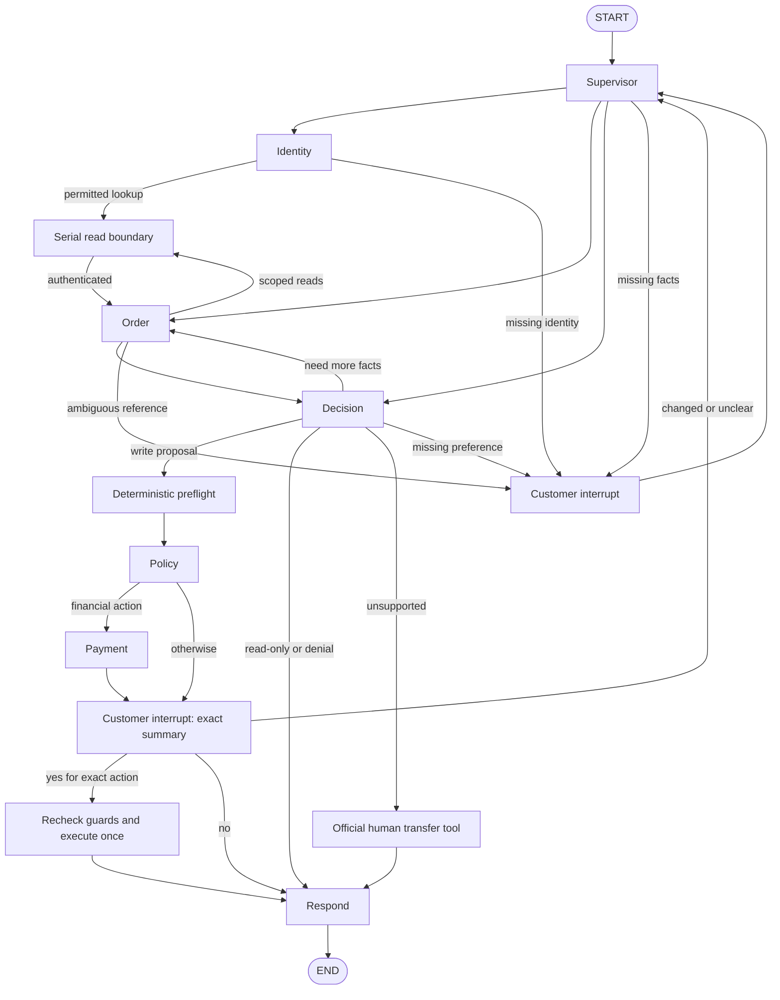

# MA-TRACE — Phase 1 Retail MAS

A LangGraph retail support system with six specialist LLM roles, customer interrupts,
and a deterministic executor over the **official τ²-bench simulated Retail tools**.
This phase implements the business MAS only. Tracing, attribution, fault injection and
recovery are future work.

Benchmark: **v1.0.1**, commit `fc0055dc4e0a316c3f83133267fbd6faaa770992`.
Development uses the 74-task train split. The 40 test tasks remain held out.
Source links and asset hashes are in `data/manifests/retail_benchmark_manifest.json`.

## Install and run

Use Python **3.12** and [uv](https://docs.astral.sh/uv/). The pinned upstream imports
`audioop` transitively, so Python 3.13 is currently excluded.

If this branch has not yet been published, import the delivered bundle into your clone first:

```bash
git fetch /path/to/MAtrace-phase1.bundle phase-1-retail-mas:phase-1-retail-mas
git switch phase-1-retail-mas
git push -u origin phase-1-retail-mas
```

The source ZIP can also be extracted and run directly, starting with `uv sync --locked`.
Once the branch is published, a fresh clone can use:

```bash
git clone https://github.com/Kaustubh1206/Multi-Agent-Trace-Recovery-System.git
cd Multi-Agent-Trace-Recovery-System
git switch phase-1-retail-mas
uv sync --locked
uv run python scripts/fetch_retail_data.py
cp .env.example .env
# Set OPENAI_API_KEY in .env; optionally RETAIL_MODEL and OPENAI_BASE_URL.
uv run python main.py --task 69
```

`--task 69` validates train membership and selects the fresh initial fixture; it does
**not** turn hidden task instructions into customer messages. You are the customer in
manual mode. Supply your request and identity facts yourself. Type `/quit` to stop.
Omit `--task` for an ordinary manual conversation over the same official DB.
API mode incurs provider costs. No local model weights are downloaded.

Provider-native structured output is tried first. A bounded JSON/text fallback validates
against the same Pydantic schema; invalid outputs fail closed. The six roles may share
one model while retaining separate system prompts, responsibilities and scoped tools.

No API key is needed for the **offline test/demo mode**:

```bash
uv run python -m tests.demo
uv run pytest tests -q --pilot-report work/offline_pilot_results.json
uv run ruff check src tests scripts main.py
uv run ruff format --check src tests scripts main.py
```

Tests replace model outputs with explicit scripts while querying and mutating real,
fresh benchmark fixtures. This demonstrates graph/tool behavior, not model intelligence.

## Graph



Routing is deterministic after structured specialist outputs. The Supervisor identifies
the current subtask; authentication gates protected activity. Order retrieves facts;
Decision proposes a single complete operation or responds/asks/transfers. Policy reviews
the already validated proposal; Payment looks up allowed methods and explains validated
consequences. Read-only requests skip Policy, Payment, confirmation and execution.

An exact affirmative customer reply is required after the canonical action summary.
`no` writes nothing; unclear replies or changed choices restart planning and require
fresh consent. The executor checks authentication, ownership, status, eligibility,
arguments, snapshot freshness, exact approval and duplicate commit independently.
There are 32 specialist steps per turn and 40 customer turns per session.

## Files and responsibilities

```text
main.py
pyproject.toml / uv.lock / requirements.txt
.env.example / .gitignore
src/retail_mas/
  __init__.py
  cli.py
  graph.py / edges.py
  states.py / objects.py
  nodes.py / prompts.py / models.py
  tools.py / policy.py / data_loader.py
scripts/fetch_retail_data.py
data/manifests/retail_benchmark_manifest.json
data/ground_truth/clean_tasks.jsonl / README.md
docs/
  DATA_TASKS_SCENARIOS_GROUND_TRUTH.md
  MA_TRACE_Final_Retail_MAS_Proposal.txt
  IMPLEMENTATION_NOTES.md / TEST_RESULTS.md
  offline_pilot_results.json / offline_demo.txt / TAU2_LICENSE.txt
tests/
  conftest.py / support.py / oracle.py / build_labels.py / demo.py
  test_data_loading.py / test_policy_guards.py / test_retail_graph.py
  test_ground_truth_isolation.py / test_models.py
```

| Module | Responsibility |
|---|---|
| `cli.py`, `main.py` | Manual customer loop, fresh session and interrupt/resume |
| `graph.py`, `edges.py` | `StateGraph`, scoped conditional routes, memory checkpoint |
| `states.py`, `objects.py` | Compact observed state and validated outputs/actions |
| `nodes.py` | Six role calls, read boundary, clarification, consent, execution, response |
| `prompts.py` | Independent narrow specialist responsibilities and pinned policy |
| `models.py` | Configurable API model and validated structured-output fallback |
| `tools.py` | Unchanged official tool APIs, serial access, auth, atomic in-memory commits |
| `policy.py` | Hard policy rules and exact confirmation summary/interpretation |
| `data_loader.py`, fetch script | Hash-verified pinned assets, train selection, fresh DB |
| `tests/oracle.py`, `build_labels.py` | Separate reference states and native ENV evaluator |

Optional state fields are safely replaced; only message history uses `add_messages`.
A new subtask clears proposals, consent, observations and execution results. Authenticated
identity stays fixed for that conversation. Create a **new adapter and graph** for every
new customer/task/trial; the CLI does this per process. Checkpoints and action records
are in memory, with no restart persistence.

## What has been verified

See [actual test results](docs/TEST_RESULTS.md) and
[raw offline ENV results](docs/offline_pilot_results.json).
Train IDs **0, 1, 47, 50, 69, 84** were run with scripted model outputs through the graph
and official tools. Native ENV-only evaluation checks their DB outcomes; supplementary
tests cover auth/ownership, consent, unrelated changes, duplicate writes, changed choices
and the transfer call. The manual demo exercises task 69's cancellation subpath.

**No live LLM dialogue, official user-simulator trial or full benchmark score is claimed.**
Simulator/orchestrator adaptation and full communication/NL grading remain to be integrated.
No test-split task was run. Multi-request completion is sequential through customer turns;
autonomous multi-goal dialogue quality remains unverified.

Ground-truth records preserve original official criteria, fixture/policy hashes and computed
reference outcomes, but remain **draft** pending independent review. They never enter agent
prompts or runtime tools. Regenerate them with `uv run python -m tests.build_labels`.

Known upstream limitations, source inspection notes and information boundaries are documented
in [implementation notes](docs/IMPLEMENTATION_NOTES.md). In particular, affected multi-item
pending modifications are blocked because of a pinned upstream price/options defect;
multi-item exchanges are tested. Non-null task initial states fail explicitly rather than
being ignored. Some official statuses/tool rules differ from the written policy; hard guards
follow the stricter policy.

Upstream assets/code: [τ²-bench](https://github.com/sierra-research/tau2-bench/tree/fc0055dc4e0a316c3f83133267fbd6faaa770992),
MIT license reproduced in `docs/TAU2_LICENSE.txt`. AgentTether's anonymous source was
inaccessible during this implementation and was not used as an unverified MAS template.
