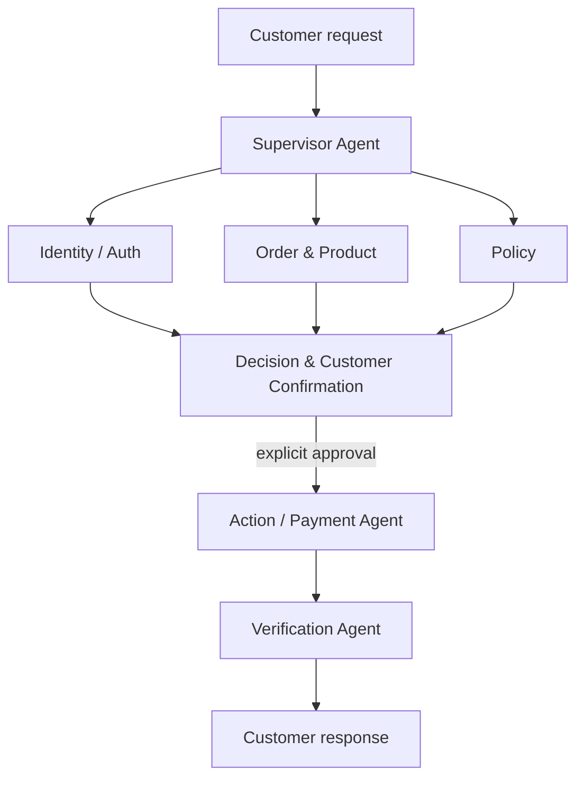

# MA-TRACE — Retail MAS

Phase 1 implements the retail multi-agent system in the proposal using LangGraph and
**official τ²-bench Retail tools/data**. LangSmith experiment visualization is optional;
MA-TRACE failure attribution, fault injection and recovery are future work.

## Architecture



These are the **seven graph nodes**. The arrows above show responsibilities, as in the
proposal. At runtime, the Supervisor gathers the specialist results in order: authenticate
first, then retrieve protected order/product data, then assess policy. Retail tools run
one at a time. The Supervisor plans once per customer turn; ordinary routing is Python.

| Agent | Responsibility |
|---|---|
| Supervisor | Understand intent, route specialists, maintain shared state |
| Identity / Auth | Locate the customer using email or name + ZIP |
| Order & Product | Retrieve owned orders, items, available variants and relevant profile facts |
| Policy | Assess eligibility and required conditions without writing |
| Decision & Customer Confirmation | Combine findings, propose an action, ask questions, obtain exact approval |
| Action / Payment | Review payment facts and execute the approved simulated change through guarded tools |
| Verification | Read the committed DB and check the result against the confirmed action |

Tools, policy checks, customer pauses and transfer are functions used by these agents;
there are no separate graph nodes for them. Missing facts or changed choices return to
Supervisor. Read-only answers, refusals and human transfers finish at Decision. Successful
writes continue through Action/Payment and Verification.

Verification uses the **customer-confirmed operation**, its disposable preflight result,
and the actual DB. Official task expectations remain in the separate test-only evaluator.
An LLM cannot override a failed deterministic check, authenticate a supplied user ID, or
mark customer approval itself. No/unclear approval performs no write. Changed choices need
fresh consent. Existing authorization, eligibility and duplicate-write guards remain active.

## Run

Use Python **3.12** and [uv](https://docs.astral.sh/uv/):

```bash
git clone --branch phase-1-retail-mas https://github.com/Kaustubh1206/Multi-Agent-Trace-Recovery-System.git
cd Multi-Agent-Trace-Recovery-System
uv sync --locked
uv run python scripts/fetch_retail_data.py
cp .env.example .env
# Set OPENAI_API_KEY in .env; optionally RETAIL_MODEL and OPENAI_BASE_URL.
uv run python main.py --task 69
```

For an existing clone, use `git fetch origin` and `git switch phase-1-retail-mas`.
No Git bundle is needed.

You are the customer in manual mode. `--task 69` validates the train ID and initial fixture;
it does **not** provide hidden task instructions to agents. Supply your own request and
identity facts. Omit `--task` for an ordinary manual conversation. `/quit` closes the session.
The example configuration uses OpenAI with `gpt-6-luna`. Put your OpenAI API key in
`OPENAI_API_KEY`. To configure an existing `.env` without replacing your key:

```dotenv
OPENAI_BASE_URL=https://api.openai.com/v1
RETAIL_MODEL=gpt-6-luna
RETAIL_REASONING_EFFORT=none
RETAIL_OUTPUT_METHOD=json
```

Use the native model ID [`gpt-6-luna`](https://developers.openai.com/api/docs/models/gpt-6-luna),
without an `openai/` prefix. Remove any old
`OPENAI_API_BASE` setting or set it to the same OpenAI endpoint: LangChain gives that
variable precedence. Exported shell values take precedence over `.env` values too.

The factory leaves temperature unset for reasoning-model compatibility. Reasoning effort
is optional for other providers; remove `RETAIL_REASONING_EFFORT` when a model does not
support it. OpenAI API usage is billed separately from ChatGPT subscriptions.

`json` asks for JSON text and validates it locally against the same Pydantic schema.
It avoids provider-specific native schema restrictions. `json_schema` optionally uses
native, non-strict JSON Schema first and falls back on format-specific rejections.
Invalid responses never bypass action guards. Authentication, rate limits and unrelated
bad requests are not treated as schema failures.

API usage is subject to your provider's plan and quotas; no local model weights are downloaded.
A rejected request now shows its HTTP status, error code/parameter and sanitized message,
without printing keys, request headers/bodies or failed generations.

Offline tests/demo require no API key:

```bash
uv run python -m tests.demo
uv run pytest tests -q --pilot-report work/offline_pilot_results.json
uv run ruff check src tests scripts main.py
```

## Automatic conversations and evaluator reports

The separate benchmark runner connects the official pinned text user simulator to the
same seven-agent MAS and grades the resulting conversation with the native τ² evaluator:

```bash
uv sync --locked
uv run python scripts/fetch_retail_data.py
uv run python -m retail_benchmark --tasks 69 --trials 1 --verbose
# After reviewing the first result, run five train tasks:
uv run python -m retail_benchmark --tasks 69 0 1 47 50 --output work/pilot-five
```

This uses your OpenAI API key for MAS, simulator and any required LLM judge calls. It runs
serially, resets the DB/identity/approval per trial, and saves native scores separately from
supplementary consent, DB-integrity and handoff checks. No live benchmark validation has
been performed here. See [the benchmark guide](docs/BENCHMARK.md) for model settings,
report fields, native scoring limitations and offline verification evidence.

## Visualize the experiment in LangSmith

For the interactive graph canvas, use **`uv run langgraph dev`** from the repository root
after `uv sync --locked` and fetching the pinned data. `langgraph.json` registers the
`retail_mas` graph. Open the printed Studio URL, create a new thread and submit a customer
request. See [Studio inputs and confirmation resumes](docs/LANGSMITH.md#run-interactively-in-studio).
Create a new thread after restarting the server; retail sessions are in memory.

Add these lines to your existing local `.env`, keeping your OpenAI configuration:

```dotenv
LANGSMITH_TRACING=true
LANGSMITH_API_KEY=your_langsmith_api_key
LANGSMITH_PROJECT=matrace-retail-pilot
LANGSMITH_ENDPOINT=https://api.smith.langchain.com
```

Run `uv sync --locked`, then `uv run python main.py --task 69`. Open the project in
[LangSmith](https://smith.langchain.com) and inspect the `retail-task-69` run. Expand agent
nodes to see model/tool activity. The CLI prints a conversation thread ID; use it in the
Threads view to group all customer turns and confirmation resumes. Type `/quit` to flush
pending traces and close the session.

Tracing is off in `.env.example`. Enabling it uploads dialogue, prompts, shared runtime
state and observed simulated retail records. Full setup, region selection, trace examples
and recording boundaries are in [the LangSmith guide](docs/LANGSMITH.md).

## Read the code

Start with `graph.py`, then the seven named agent functions in `nodes.py`.

| File | Contents |
|---|---|
| `src/retail_mas/graph.py`, `edges.py` | Seven nodes and Supervisor routing |
| `nodes.py`, `prompts.py` | Agent functions, narrow responsibilities and customer confirmation |
| `states.py`, `objects.py` | Shared observed state and validated outputs |
| `tools.py`, `policy.py` | Official tool adapter and deterministic checks |
| `models.py` | One configurable API model with a validated JSON fallback |
| `data_loader.py`, `scripts/fetch_retail_data.py` | Pinned assets and fresh fixtures |
| `cli.py`, `main.py` | Manual customer loop |
| `langgraph.json`, `studio.py` | Local Agent Server / Studio entry point and isolated thread sessions |
| `src/retail_benchmark/` | Separate automatic customer loop, actual tool trajectory and native grading |
| `tests/` | Scripted model tests, real tools and separate benchmark evaluator |

Each customer/task/trial needs a **new adapter and graph**. The CLI creates them on startup.
A customer can make several requests in one session. A new request clears old task results
and approval while retaining that customer's identity. Direct graph callers must set
`new_request=True` for a new customer turn and use `Command(resume=...)` for an interrupt.
Sessions are in memory; process-restart persistence is not implemented.

## Data and verification status

τ²-bench **v1.0.1**, commit `fc0055dc4e0a316c3f83133267fbd6faaa770992`, is pinned in the
lockfile and manifest. Asset hashes and source URLs are in
`data/manifests/retail_benchmark_manifest.json`. Development uses train (74); test (40) is held out.

See [test results](docs/TEST_RESULTS.md), [raw offline ENV results](docs/offline_pilot_results.json)
and [implementation notes](docs/IMPLEMENTATION_NOTES.md). Pilots `0`, `1`, `47`, `50`, `69`,
`84` use scripted LLM outputs and real official tools. They demonstrate plumbing and guards,
not live-model performance. The official text simulator and native communication/NL grading
are now integrated through the separate benchmark runner and tested with intercepted model
responses. Live benchmark validation remains pending; no pass rate is claimed. Ground-truth
labels remain draft.

The pinned upstream has a pending multi-item modification defect; affected operations fail
closed. Multi-item exchanges are tested. Non-null task initial states fail explicitly.
Python 3.13 is excluded because the pinned package imports `audioop` transitively.

Upstream code/data are MIT-licensed; see `docs/TAU2_LICENSE.txt`. AgentTether's anonymous
source was inaccessible and was not used as an unverified MAS template.
