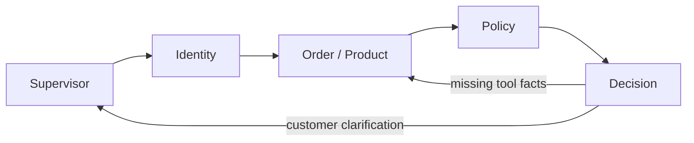

# Custom Retail MAS

This branch implements five LLM agents: Supervisor, Identity, Order/Product, Policy,
and Decision. It preserves the official τ²-bench v1.0.1 Retail data, tools, simulator
and evaluator pinned to `fc0055dc4e0a316c3f83133267fbd6faaa770992`.
The earlier seven-agent experiment remains on `phase-1-retail-mas`.

## Workflow

The normal path is:



All five roles invoke the configured LLM with separate prompts and scopes. Identity
and Order can perform successive serial reads. Decision proposes an action and pauses
for explicit customer approval. On approval, Python executes and verifies the exact
prepared operation. These are internal checks, not extra LLM agents or graph nodes.

Decision may include later complete calls in `following_actions` for multi-order
requests. Only the current action is prepared; each later action is prepared against
fresh DB state and separately confirmed. A changed/unclear reply discards queued calls
and replans. Failed verification stops further actions.

## Install and start

```bash
git fetch origin
git switch custom-retail-mas
uv sync --locked
uv run python scripts/fetch_retail_data.py
```

Keep your existing OpenAI credentials in `.env`; safe examples are in `.env.example`.
The existing `RETAIL_MODEL` and `RETAIL_OUTPUT_METHOD` remain configurable.

```dotenv
OPENAI_API_KEY=your-key
OPENAI_BASE_URL=https://api.openai.com/v1
RETAIL_MODEL=gpt-6-luna
RETAIL_OUTPUT_METHOD=json
RETAIL_MAX_MODEL_CALLS=32
RETAIL_MAX_OUTPUT_TOKENS=1024

LANGSMITH_TRACING=true
LANGSMITH_API_KEY=your-langsmith-key
LANGSMITH_PROJECT=matrace-retail-custom
```

Run a manual conversation or open Studio:

```bash
uv run python main.py --task 69
uv run langgraph dev
```

Studio uses the existing `langgraph.json` entry point and shows the five roles.
Create a new Studio thread when starting a new customer. Sessions/DBs are in-memory;
restart creates a new session, not a durable retail service. See [LangSmith](docs/LANGSMITH.md).

## Cost controls

- Full pinned policy text goes only to Policy; other roles have shorter scope prompts.
- The Supervisor receives no retail tool payloads. Model context uses the latest eight
  dialogue messages plus the maintained request purpose; full dialogue stays in the
  benchmark trajectory. Repeated reads are deduplicated in model context.
- Approved execution, payment checks and DB verification make no model requests.
- `RETAIL_MAX_MODEL_CALLS` caps logical MAS requests per conversation, including JSON
  fallbacks. SDK transport retries can still make extra HTTP attempts.
- Each report includes `mas_usage`: calls, provider-reported input/output/cached tokens,
  usage coverage and per-role totals. Missing usage is visible through coverage counts.

Simulator and native NL-judge API usage is separate and excluded from MAS token totals.
No dollar savings or live success-rate improvement is claimed. Model choice, retries,
reasoning tokens and provider pricing affect actual cost.

## Reproducible experiment

The official split has 74 train and 40 test tasks. The checked-in
[experiment manifest](data/manifests/retail_experiment_manifest.json) divides train into:

| Group | Count | Use |
|---|---:|---|
| Development | 17 | Iterate on behavior; includes the 16 previously discussed cases plus ID 2 |
| Fixed training baseline | 57 | Compare frozen system versions with the same IDs/settings |
| Official test | 40 | Final evaluation after design/model choices are frozen |

Once baseline feedback influences changes it is development evidence. Keep the official
test split untouched until final evaluation. The current CLI continues to accept train only.

Start small before the 57-task run:

```bash
uv run python -m retail_benchmark --tasks 69 0 1 --output work/custom-smoke --verbose
uv run python -m retail_benchmark --cohort baseline --dry-run
uv run python -m retail_benchmark --cohort baseline --trials 1 --seed 300 --output work/custom-baseline
uv run python -m retail_benchmark --inspect work/custom-baseline
```

Record `git rev-parse HEAD`, model settings, seed and budgets with each comparison.
The dry run makes no model requests. A full one-trial baseline contains 57 conversations;
three trials contain 171. Simulator and judge retain the existing model configuration.

## Modules

The project layout is retained:

| Module | Responsibility |
|---|---|
| `graph.py`, `edges.py` | Five-node graph and deterministic routes |
| `nodes.py` | Five specialist roles, customer pause/resume, internal execution/verification |
| `states.py`, `objects.py` | Typed shared state and validated structured outputs |
| `prompts.py`, `models.py` | Role prompts, one model factory, request budgets and usage counters |
| `tools.py`, `policy.py` | Official adapter; authentication, ownership, eligibility and consent guards |
| `data_loader.py` | Pinned assets and fresh per-trial DB |
| `studio.py`, `cli.py` | LangGraph Studio and manual customer mode |
| `retail_benchmark/` | Official simulator, actual tool recording, native evaluation and saved reports |

## Verification and limits

```bash
uv run ruff check src tests scripts main.py
uv run pytest tests -q
```

Tests use offline model responses with real pinned tools/fixtures and native graders.
They cover consent, ownership, stale/tampered actions, returns/exchanges, multiple queued
orders, usage accounting, isolation, Studio and local LangSmith traces. Actual results
and limitations are recorded in [TEST_RESULTS.md](docs/TEST_RESULTS.md).

The official evaluator and oracle fields remain outside agent contexts. Test labels
remain draft. The known pinned multi-item pending-modification defect still fails closed;
policy is not changed to force a score. Non-null initial-state/history overrides and
durable/multiworker sessions remain unsupported. Context summarization and LLM choices
can still fail: API-backed validation is required before interpreting quality or savings.

No fault injection, causal diagnosis, replay or recovery implementation is included.
